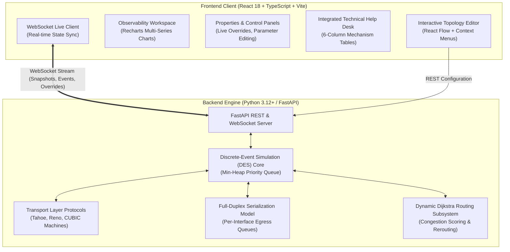
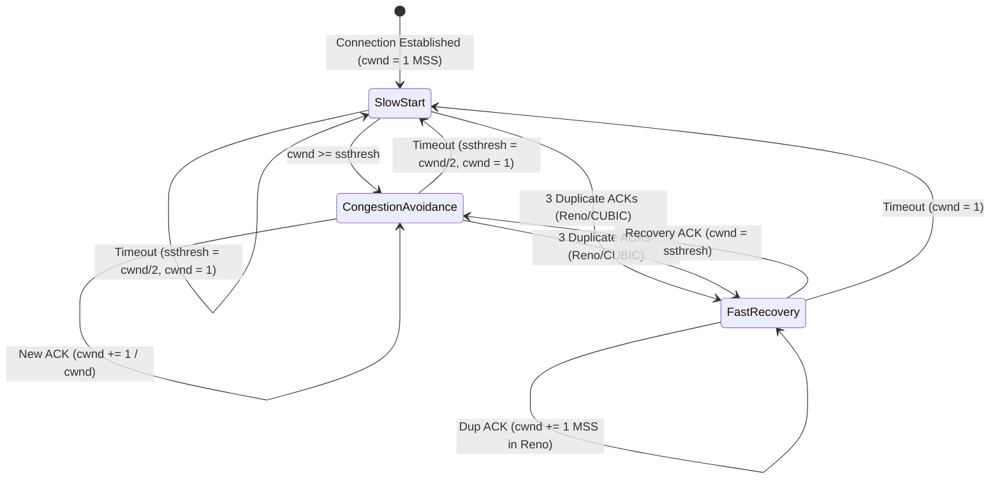

# NetLab — Congestion Detection & Traffic Rerouting Simulator

[](https://fastapi.tiangolo.com)
[](https://www.python.org)
[](https://react.dev)
[](https://vitejs.dev)
[](https://tailwindcss.com)
[]()
[](https://www.docker.com)

> **NetLab** is an interactive, full-stack computer networking laboratory and discrete-event simulation platform designed for university students, educators, and network systems engineers. It models the mechanics of packet queueing, congestion collapse, packet loss recovery, transport-layer protocol state transitions (**TCP Tahoe, Reno, and CUBIC**), and autonomous traffic rerouting across dynamic network topologies.

---

## 📑 Table of Contents

1. [Executive Summary & Problem Statement](#1-executive-summary--problem-statement)
2. [High-Level Architecture & Technology Stack](#2-high-level-architecture--technology-stack)
3. [The Simulation Core: Discrete-Event Engine Under the Hood](#3-the-simulation-core-discrete-event-engine-under-the-hood)
4. [Transport-Layer Protocols: Mathematics & State Machines](#4-transport-layer-protocols-mathematics--state-machines)
5. [Congestion Detection & Autonomous Traffic Rerouting](#5-congestion-detection--autonomous-traffic-rerouting)
6. [Packet Loss & Physical Network Modeling](#6-packet-loss--physical-network-modeling)
7. [UI & Observability Workspace](#7-ui--observability-workspace)
8. [Curated Reference Scenarios (Unit 3 Alignment)](#8-curated-reference-scenarios-unit-3-alignment)
9. [Automated Verification & Test Suite](#9-automated-verification--test-suite)
10. [Quick Start & Deployment](#10-quick-start--deployment)

---

## 1. Executive Summary & Problem Statement

### The Educational Challenge
In computer networking education (specifically transport-layer dynamics and queueing theory), students frequently struggle with abstract mathematical concepts:
* Why does throughput drop when link utilization approaches 100%?
* How does a finite router buffer trigger a catastrophic goodput collapse?
* What is the mathematical difference between **additive increase** in TCP Reno and **time-based cubic scaling** in TCP CUBIC?
* Why do premature timeouts produce unneeded duplicates that permanently waste channel capacity?

Existing network simulators (such as NS-3 or Mininet) have steep learning curves, require complex C++/Python scripting, and lack real-time graphical transparency. Conversely, existing web visualizers are usually static animations or toy canvas mockups lacking deterministic packet physics, true protocol state machines, and real queueing equations.

### The Solution: NetLab
NetLab bridges this gap by combining:
1. **A true discrete-event simulation (DES) engine** implemented in Python that executes priority-queue packet scheduling, serialization delays, propagation delays, and output-buffered queueing down to microsecond precision.
2. **Deterministic, standards-compliant protocol implementations** of TCP Tahoe (1988), TCP Reno (1990), and TCP CUBIC (RFC 8312 / RFC 9438).
3. **An interactive node-and-wire topology canvas** powered by React Flow and Tailwind CSS, featuring context menus, dynamic cable cutting, live parameter mutation, and synchronized multi-metric observability charts.
4. **An automated traffic engineering subsystem** that computes multi-metric congestion scores and calculates dynamic bypass routes using Dijkstra's algorithm.

---

## 2. High-Level Architecture & Technology Stack

NetLab is structured as a decoupled client-server architecture with synchronized WebSocket streaming and RESTful management APIs:



### Architectural Separation
* **Frontend**: Pure functional React 18, TypeScript, Tailwind CSS, Lucide icons, Recharts for time-series analytics, and React Flow for topology rendering.
* **Backend API**: FastAPI with Pydantic v2 validation models, asynchronous WebSocket endpoints for tick-driven simulation streaming, and REST endpoints for catalog queries and parameter updates.
* **Simulation Core**: Event-driven Python engine decoupled from the web framework, enabling head-to-head benchmarking, headless execution, and deterministic unit testing with `pytest`.

---

## 3. The Simulation Core: Discrete-Event Engine Under the Hood

Unlike tick-based game loops or approximate polling models, NetLab implements a **pure discrete-event simulation (DES)** architecture.

### 3.1 Priority Queue Event Scheduling
Simulation time $\tau$ advances discontinuously from one event timestamp to the next using a min-heap priority queue ($O(\log N)$ per operation):

$$\mathcal{Q} = \text{heapq}(\{ e_1, e_2, \dots, e_n \}), \quad \text{where } e_i = (\tau_i, \text{EventType}, \text{FlowID}, \text{Packet}, \dots)$$

The simulation loop continuously pops the earliest event:
1. `PACKET_GENERATE`: Application layer dispatches segments based on $\min(cwnd, rwnd)$.
2. `ROUTER_ARRIVAL`: Segment arrives at a router after traversal across an inbound link.
3. `ROUTER_DEPART`: Segment completes line-rate serialization on the egress network interface card.
4. `RECEIVER_ARRIVAL`: Packet reaches the destination; cumulative/duplicate ACKs are formed.
5. `ACK_ARRIVAL`: Feedback arrives at the sender, driving window adjustments.
6. `RETRANSMISSION_TIMEOUT`: RTO timer fires for an unacknowledged segment.
7. `CONGESTION_CHECK`: Periodic link evaluation for automated traffic rerouting.

### 3.2 Physical Link & Serialization Physics
Network links are modeled with rigorous transmission physics:

$$\text{Total Hop Delay} = T_{\text{ser}} + T_{\text{prop}}$$

* **Serialization Delay ($T_{\text{ser}}$)**: The time required to push packet bits onto the physical transmission medium:
  $$T_{\text{ser}} = \frac{L \times 8}{R} \quad \left[\text{seconds}\right]$$
  where $L$ is packet size in bytes (e.g. 1400 bytes MSS or 40 bytes TCP ACK) and $R$ is link bandwidth in bps.
* **Propagation Delay ($T_{\text{prop}}$)**: Time spent traveling along the medium at the speed of light in copper/fiber ($d / v$).

### 3.3 Full-Duplex Directional Serialization & Per-Interface Egress Queuing
To accurately reflect physical Ethernet and optical links, NetLab incorporates:
1. **Directional Transmitter Busy Tracking**: Link transmitter state is tracked as `link_tx_busy[(link_id, transmitter_node)]`. Forward data packets from Node A to Node B do not contend with or block reverse ACKs from Node B to Node A.
2. **Per-Egress-Interface Queues**: Routers maintain independent FIFO output queues for every egress network interface:
   $$\text{Queue}_{(r, \ell)} = \text{deque}(\text{packets waiting for link } \ell)$$
   When link $\ell$ finishes transmission, its egress transmitter dequeues the next packet waiting specifically for link $\ell$ at line rate, preventing head-of-line blocking across unrelated router ports.

---

## 4. Transport-Layer Protocols: Mathematics & State Machines

NetLab features production-grade reference implementations of the classic and modern TCP congestion control algorithms.



### 4.1 TCP Tahoe (1988)
* **Slow Start**: For every received ACK, window increments by 1 MSS:
  $$cwnd \leftarrow cwnd + 1 \implies \text{Doubles every RTT}$$
* **Congestion Avoidance**: For every received ACK, window increments additively:
  $$cwnd \leftarrow cwnd + \frac{1}{cwnd} \implies +1 \text{ MSS per RTT}$$
* **Loss Handling**: On **both** 3 duplicate ACKs and RTO timeout:
  $$ssthresh \leftarrow \max\left(2, \frac{cwnd}{2}\right), \quad cwnd \leftarrow 1.0\text{ MSS}, \quad \text{State} \leftarrow \text{SlowStart}$$

### 4.2 TCP Reno (1990)
Reno introduces **Fast Retransmit** and **Fast Recovery**:
* **On 3 Duplicate ACKs**:
  $$ssthresh \leftarrow \max\left(2, \frac{cwnd}{2}\right)$$
  $$cwnd \leftarrow ssthresh + 3.0 \quad (\text{inflated for the 3 segments that exited the network})$$
  $$\text{State} \leftarrow \text{FastRecovery}$$
  The missing segment ($ack\_num + 1$) is immediately retransmitted.
* **During Fast Recovery**: Each additional duplicate ACK increments $cwnd \leftarrow cwnd + 1.0$. If $in\_flight < cwnd$, new packets are transmitted.
* **On Recovery ACK**: Deflates window back to baseline and transitions directly to Congestion Avoidance:
  $$cwnd \leftarrow ssthresh, \quad \text{State} \leftarrow \text{CongestionAvoidance}$$
* **On Timeout**: Falls back to Slow Start ($cwnd = 1.0\text{ MSS}$).

### 4.3 TCP CUBIC (RFC 8312 / RFC 9438)
The default congestion control algorithm in Linux, macOS, and Windows. CUBIC decouples window growth from RTT by calculating window size as a function of elapsed time $t$ since the last congestion event:

$$W_{\text{cubic}}(t) = C \cdot (t - K)^3 + W_{\max}$$

Where:
* $W_{\max}$: Congestion window prior to the loss event.
* $\beta = 0.70$: Multiplicative decrease factor (cuts window to $70\%$ rather than Reno's $50\%$).
* $C = 0.4$: CUBIC scaling constant.
* $K$: Time period required for the function to climb back to $W_{\max}$ without loss:
  $$K = \sqrt[3]{\frac{W_{\max} \cdot (1 - \beta)}{C}}$$

```text
  Window Size (cwnd)
        ^
  W_max | - - - - - - - - - - - - - - - - - - * (Inflection Plateau at t = K)
        |                                   *   *
        |                                 *       * (Concave probing)
        |           * * * * * * * * * * *
        |         *
  ssthresh|     * (Convex acceleration)
        |   *
        +----------------------------------------> Time (t)
            t=0                              t=K
```

* **Plateau Probing**: As $t \to K$, window growth flattens, maximizing stability near previous channel capacity. When $t > K$, the cubic curve accelerates concave-upward to explore newly available bandwidth.
* **TCP-Friendly Region**: If the cubic curve would grow slower than standard Reno on short-RTT connections, CUBIC computes an emulation floor $W_{\text{tcp}}(t)$ to guarantee Reno-friendliness:
  $$W_{\text{tcp}}(t) = W_{\max} \cdot \beta + \left(\frac{3(1 - \beta)}{1 + \beta}\right) \cdot \frac{t}{\text{RTT}}$$

### 4.4 Round-Trip Time (RTT) & Retransmission Timeout (RTO)
RTO is computed continuously using the **Jacobson/Karn algorithm** (RFC 6298):

$$\text{SampleRTT} = \tau_{\text{ack\_received}} - \tau_{\text{packet\_sent}}$$
$$\text{SRTT} \leftarrow (1 - \alpha) \cdot \text{SRTT} + \alpha \cdot \text{SampleRTT} \quad (\alpha = 0.125)$$
$$\text{RTTVAR} \leftarrow (1 - \beta) \cdot \text{RTTVAR} + \beta \cdot |\text{SRTT} - \text{SampleRTT}| \quad (\beta = 0.25)$$
$$\text{RTO} \leftarrow \text{SRTT} + \max(G, 4 \times \text{RTTVAR})$$

On an unacknowledged timeout, exponential backoff doubles the timer: $\text{RTO} \leftarrow \min(2 \times \text{RTO}, 3.0\text{s})$.

---

## 5. Congestion Detection & Autonomous Traffic Rerouting

In addition to end-to-end transport control, NetLab models **Layer 3 traffic engineering and dynamic route diversion**.

### 5.1 Multi-Metric Link Congestion Scoring
The engine periodically computes a normalized congestion score $S(e) \in [0.0, 1.0]$ for every active link $e = (u, v)$:

$$S(e) = \min\left(1.0, \; w_q \cdot \frac{q_e}{Q_{\max}} + w_b \cdot \text{Busy}(e) + w_{\text{loss}} \cdot \text{LossRate}(e)\right)$$

Where:
* $q_e / Q_{\max}$: Router egress queue buffer occupancy ratio ($w_q = 0.7$).
* $\text{Busy}(e)$: Instantaneous transmission status ($1.0$ if currently serializing, $0.0$ if idle, $w_b = 0.3$).
* $\text{LossRate}(e)$: Packet drop probability on the link.

### 5.2 Congestion-Aware Dijkstra Rerouting
When a bottleneck link exceeds its operational threshold (default $70\%$ buffer occupancy):
1. NetLab calculates dynamic edge weights combining base propagation cost with congestion penalties:
   $$\text{Weight}(e) = \text{Delay}_{\text{base}}(e) \times \left(1.0 + \kappa \cdot S(e)^2\right)$$
2. Dijkstra's shortest-path algorithm determines whether an alternate lower-cost path exists (e.g. secondary bypass path).
3. If an alternative path is superior, traffic is seamlessly diverts:
   $$\text{Path}_{\text{new}} = \text{Dijkstra}(\text{Source}, \text{Destination})$$
4. All route changes are logged with before-and-after throughput, RTT, and transition metrics.

---

## 6. Packet Loss & Physical Network Modeling

NetLab provides realistic simulation of packet drop dynamics across multiple network layers:

| Loss Mechanism | Physical / Logical Cause | Trigger Threshold | Protocol Reaction |
| :--- | :--- | :--- | :--- |
| **Tail Drop Overflow** | Bottleneck link capacity exceeded; queue buffer full | $\text{len}(\text{Queue}) \ge \text{BufferCapacity}$ | Tail packets discarded; triggers 3 dup ACKs or RTO timeout |
| **Random Link Loss** | Bit error rate (BER), optical attenuation, wireless fading | Bernoulli trial: $\text{rand}() < \text{LossRate}$ | Induces isolated packet drops even when queues are empty |
| **Explicit Congestion Notification (ECN)** | Router queue buildup prior to loss | $\text{len}(\text{Queue}) / Q_{\max} \ge \text{Threshold}_{\text{ECN}}$ | CE bit set on IP packet; receiver echoes ECE; sender halves window without dropping packets |
| **Cable Cut / Physical Failure** | Severed cable, fiber cut, or interface shutdown | User right-clicks link $\to$ "Cut connection" | 100% loss until alternate path is computed or link restored |

---

## 7. UI & Observability Workspace

NetLab was built to adhere to professional observability principles, avoiding cluttered toy interfaces in favor of high-density technical controls:

```text
+---------------------------------------------------------------------------------------------------+
|  NETLAB: Congestion Detection & Traffic Rerouting Lab           [Step] [Run] [Pause] [Speed: 1x] |
+-------------------------------------------------------------+-------------------------------------+
|                                                             | PROPERTIES PANEL                    |
|                      TOPOLOGY CANVAS                        | Selected: Shared Bottleneck Router |
|                                                             |-------------------------------------|
|   [Sender 1: Reno] -----\                                   | Type: Router                        |
|                          +---> [ Core Router ] ---> [ Rcv ] | Buffer Capacity: [ 12 pkts ]        |
|   [Sender 2: CUBIC] ----/       (Queue: 4/12)               | Live Occupancy:  [ 4 / 12 pkts ]    |
|                                                             | Drop Policy:     [ Tail Drop  v ]   |
|   (Right-click context menus for cable cutting & editing)   | Congestion Score: 0.35              |
+-------------------------------------------------------------+-------------------------------------+
|                      OBSERVABILITY WORKSPACE & CHARTS                                             |
|  [Congestion Window (cwnd)]  [Goodput & Delivery]  [RTT & Queue Delay]  [Event Inspector]        |
|  * Reno Sawtooth (Fast Recovery)    * CUBIC Acceleration Curve    * Queue Occupancy Over Time     |
+---------------------------------------------------------------------------------------------------+
```

### Key UI Features
* **Interactive Node Palette**: Drag-and-drop TCP Senders, Receivers, Routers, and Hubs with real-time SVG animated packet streams.
* **Right-Click Context Menus**: Click any component or edge to edit properties, cut cables, duplicate nodes, alter bandwidth, or toggle bottleneck markers.
* **Unified Properties Panel**: Live editing of application rates (Greedy vs Rate-Metered), MSS, buffer capacities, link delays, loss rates, and manual `cwnd` overrides.
* **Multi-Series Analytics**: Synchronized charts plotting live `cwnd`, `ssthresh`, instantaneous goodput (Mbps), RTT (ms), and Jain's Fairness Index.
* **Event Inspector**: Real-time bounded audit log with categorization (`FAST_RETRANSMIT`, `DROP_BUFFER_FULL`, `TIMEOUT`, `TRAFFIC_REROUTE`, `ECN_MARKED`).
* **Integrated Help Desk**: 13 technical manuals categorized across Beginner, Intermediate, and RFC-level Advanced depths with structured 6-column mechanism tables.

---

## 8. Curated Reference Scenarios (Unit 3 Alignment)

NetLab includes 7 pre-configured benchmark scenarios mapped directly to university networking curricula:

```text
scenarios/
├── scenario_1_flow_vs_congestion.json   # cwnd vs rwnd limits on transmission
├── scenario_2_infinite_buffer.json      # Throughput caps at R/2, queueing delay explodes
├── scenario_3_finite_buffer.json        # Buffer drops, premature timeouts, retransmission waste
├── scenario_4_multi_hop.json            # Multi-hop congestion collapse from cross-traffic
├── scenario_5_tahoe_vs_reno.json        # Fast Recovery vs Slow-Start Reset
├── scenario_6_reno_vs_cubic.json        # High BDP link: Additive Increase vs Cubic Curve
└── scenario_7_rerouting_demo.json       # Dynamic congestion detection & bypass rerouting
```

### Scenario Breakdown

1. **Scenario 1: Flow Control vs Congestion Control (`rwnd` vs `cwnd`)**
   * *Concept*: Effective window is strictly bounded by $\min(cwnd, rwnd)$.
   * *Observation*: Senders expand `cwnd` exponentially during Slow Start until bounded by `rwnd = 16 MSS`, demonstrating that receiver capacity prevents sender overflow even on gigabit pipes.
2. **Scenario 2: Infinite-Buffer Idealization**
   * *Concept*: Idealized infinite buffer eliminates packet drops but causes delay explosion.
   * *Observation*: Zero packets are lost, but as arrival rate approaches capacity, queueing delay explodes asymptotically ($T_{\text{queue}} \to \infty$).
3. **Scenario 3: Finite Buffers & Retransmission Waste**
   * *Concept*: Buffer overflow drops trigger retransmissions; premature timeouts generate duplicates.
   * *Observation*: Useful delivered goodput collapses well below total transmitted throughput due to unneeded duplicate packets.
4. **Scenario 4: Multi-Hop Congestion Collapse**
   * *Concept*: Cross-traffic congests downstream links, dropping packets whose upstream transmission capacity was wasted.
   * *Observation*: Flow A travels across two hops; competing Flow B joins at Router 2. When Router 2 discards Flow A packets, all transmission capacity consumed on Hop 1 is completely wasted.
5. **Scenario 5: TCP Tahoe vs TCP Reno**
   * *Concept*: Side-by-side execution under identical packet drops.
   * *Observation*: On 3 duplicate ACKs, Tahoe collapses to $1.0\text{ MSS}$, while Reno cuts to $ssthresh = cwnd/2$ and enters Fast Recovery, maintaining high pipeline utilization.
6. **Scenario 6: TCP Reno vs TCP CUBIC (High-BDP Fat Pipe)**
   * *Concept*: Performance on a high-bandwidth high-latency pipe (100 Mbps, 50 ms delay).
   * *Observation*: Reno takes hundreds of RTT rounds to recover additively ($+1\text{ MSS/RTT}$). CUBIC cuts to $0.70 \times W_{\max}$ and quickly returns along its cubic curve, showcasing its inflection plateau.
7. **Scenario 7: Congestion Detection & Dynamic Rerouting**
   * *Concept*: Automated Layer 3 traffic diversion around congested links.
   * *Observation*: Primary low-latency 5 Mbps path congests above $70\%$ buffer occupancy. Congestion detector activates and diverts traffic across the secondary 20 Mbps path, restoring goodput.

---

## 9. Automated Verification & Test Suite

NetLab is thoroughly verified with an automated test suite executed via `pytest`.

```bash
pytest -o pythonpath=backend backend/tests
```

### Test Coverage Highlights
* **`test_reno_vs_cubic_distinct_dynamics`**: Verifies that Reno enters Fast Recovery (sawtooth at $ssthresh$), CUBIC scales along its cubic curve, and neither protocol flatlines after packet loss.
* **`test_tahoe_vs_reno_comparison`**: Verifies that Tahoe collapses to $1.0\text{ MSS}$ on loss while Reno maintains throughput via Fast Recovery.
* **`test_router_queue_drains_dynamically`**: Confirms that router queue occupancy empties to 0 at line rate when traffic is throttled or completed, verifying absence of interface deadlock.
* **`test_finite_buffer_overflow_drop`**: Verifies tail drop behavior when bottleneck queue exceeds buffer limit.
* **`test_infinite_buffer_zero_drops`**: Asserts that infinite buffer configurations produce exactly 0 dropped packets.
* **`test_simulation_determinism`**: Guarantees identical execution trajectories across identical random seeds.
* **`test_traffic_rerouting_execution`**: Validates automated Dijkstra path recalculation upon congestion threshold triggers.
* **`test_api_endpoints`**: Tests REST topology loaders, scenario catalogs, parameter mutation, and WebSocket handshake endpoints.

---

## 10. Quick Start & Deployment

### Prerequisites
* Python 3.10+ (Python 3.12+ recommended)
* Node.js 18+ and npm

### Local Development Setup

#### 1. Backend Server
```bash
# Clone the repository
cd CN_CCR_2

# Install Python requirements
pip install -r backend/requirements.txt

# Start FastAPI backend server with reload enabled
uvicorn app.main:app --host 127.0.0.1 --port 8000 --reload --app-dir backend
```
* **API Documentation**: [http://127.0.0.1:8000/docs](http://127.0.0.1:8000/docs)
* **WebSocket Endpoint**: `ws://127.0.0.1:8000/api/v1/ws/{sim_id}`

#### 2. Frontend Application
In a separate terminal:
```bash
cd frontend

# Install dependencies
npm install

# Start Vite development server
npm run dev
```
* **Application URL**: [http://localhost:5173](http://localhost:5173)

---

### Docker Compose Deployment (Optional)

Run the entire application in isolated containers with a single command:
```bash
docker-compose up --build
```
* Frontend: [http://localhost:5173](http://localhost:5173)
* Backend API: [http://localhost:8000](http://localhost:8000)

---

## 📚 References & Standards

* **Computer Networks Unit 3**: *Congestion Control, Retransmissions, and Traffic Rerouting*
* **RFC 793**: *Transmission Control Protocol (TCP Specification)*
* **RFC 5681**: *TCP Congestion Control (Tahoe, Reno, Fast Recovery)*
* **RFC 8312 / RFC 9438**: *CUBIC for Fast and Long-Distance Networks*
* **RFC 6298**: *Computing TCP's Retransmission Timer (Jacobson/Karn Algorithm)*
* **RFC 3168**: *The Addition of Explicit Congestion Notification (ECN) to IP*

---

### License & Academic Integrity
This project is open-source under the MIT License and developed as an educational demonstration of transport-layer and network-layer engineering principles.
